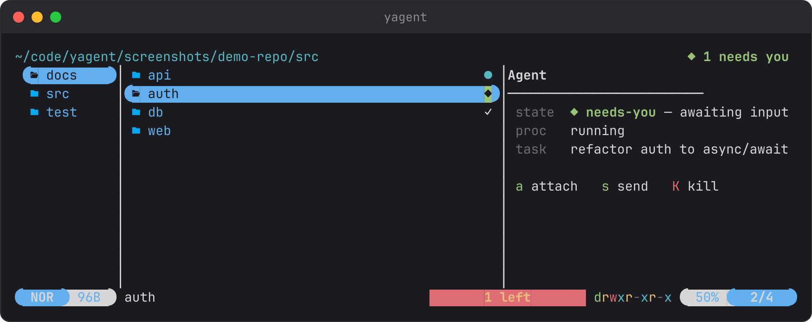
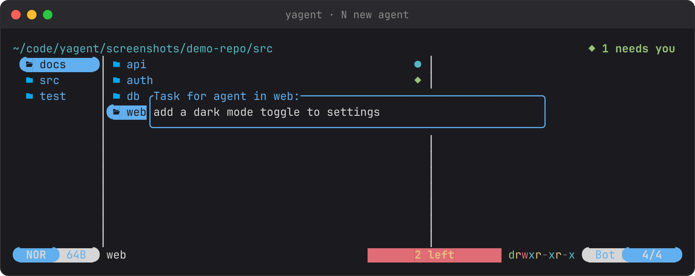
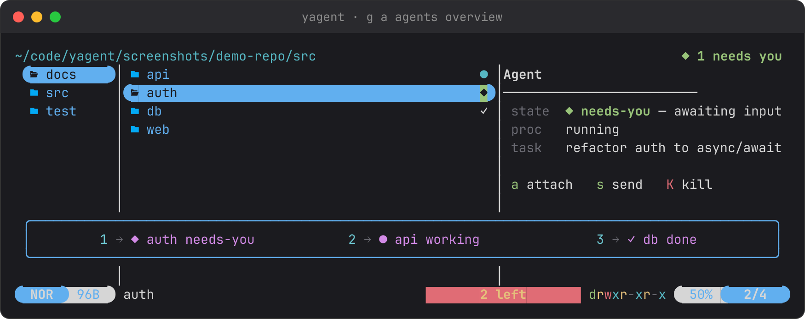

# yagent

yagent turns [yazi](https://yazi-rs.github.io/), the terminal file manager, into a control
panel for [Devin CLI](https://docs.devin.ai/) agents. You browse your repo as usual; any
folder can have an agent *attached* to it, and the folder itself tells you whether that agent
is working, done, or waiting on you.



*Three agents in `src/`: `api` is working (`●`), `auth` needs you (`◆`), `db` is done (`✓`).
Hovering `auth` opens its panel. The chip in the header counts agents waiting for you, wherever
you are in the tree.*

## The idea

Running one agent is easy. Running several means cycling through terminals to find out which
one is stuck on a question. yagent moves that information onto the thing you already look at,
the file tree, so you can start agents, wander off, and get pulled back exactly when one needs
you.

- **A folder is the unit.** An agent is attached to a folder, like a git status or a file size.
  `Enter` still opens the folder; the agent is a second layer over the same tree.
- **Glyphs are the status.** Folders with agents get a coloured glyph. Everything else is
  plain yazi.
- **One question matters: does this need me?** `◆ needs-you` is the only state that rings the
  terminal bell, lights the header chip, and sorts to the top of the overview.

| Glyph | State | Meaning | Your move |
| - | - | - | - |
| `●` cyan | working | thinking or running a tool | leave it alone |
| `◆` green | **needs you** | finished a turn or asking permission | `a` to jump in |
| `○` dim | idle | just launched, nothing yet | wait |
| `✓` gray | done | session ended | review, then `c` to clear |
| `·` dim / `✕` red | dead / error | process vanished or crashed | `c` to clear |

## Install

You need [yazi](https://yazi-rs.github.io/) (a recent release with the plugin API), the
[Devin CLI](https://docs.devin.ai/) (`devin`), `tmux`, and `git`.

    git clone https://github.com/adames/yagent.git
    cd yagent
    ./install.sh
    yagent ~/code/your-repo      # new shell first, or: source ~/.zshrc

`install.sh` adds yagent's lifecycle hooks to your user-level Devin config (it backs the file
up first and never overwrites hooks you already have), copies the helper scripts to
`~/.local/share/yagent`, and adds a `yagent` alias to your shell profile. `yagent` launches
yazi with an isolated `YAZI_CONFIG_HOME`, so your own yazi setup is untouched. To add the
plugin to your existing yazi config instead, see
[Use it inside your own yazi](#use-it-inside-your-own-yazi).

## Your first agent

1. **Hover a folder and press `N`.** Describe the task in one line and press Enter.

   

2. **You land in the agent's REPL.** Each agent runs `devin` in its own tmux session, started
   in that folder. Watch it begin, add detail if you like, then detach with `Ctrl-b d`.

3. **Back in yazi, keep browsing.** The folder shows `○` while the agent launches and `●`
   once it is working. Open other folders, start more agents.

4. **The summon.** When the agent finishes a turn or needs permission, its glyph turns `◆`,
   the bell rings, and the header shows `◆ 1 needs you`. Hover the folder and press `a` to
   drop back into its REPL. Detach again when you are done.

5. **Finish.** When the session ends the glyph turns `✓`. Press `c` to clear it from the tree.

`s` sends a one-off message to the agent without attaching; `K` kills it.

## Many agents at once

`g a` opens the Agents Overview: every agent in the repo, sorted by urgency (needs-you,
working, idle, error, done). Press a row's number to jump to that folder, then `a` to attach.



**Already inside tmux?** Attaching would nest sessions, so yagent switches your tmux client to
the agent's session instead. `Ctrl-b L` brings you back to yazi; `Ctrl-b s` lists every
session if you lose track.

## Keys

| Key | Action |
| - | - |
| `N` | New agent on the hovered folder: ask for a task, launch, attach |
| `a` | Attach to the hovered folder's agent |
| `s` | Send a one-off message to the agent |
| `K` | Kill the agent (asks first) |
| `c` | Clear a finished agent (done, dead, or error) |
| `r` | Re-read agent state and prune stale locks |
| `g a` | Agents Overview, sorted by urgency |
| `Enter` | Open the folder, as always |

## How it works

```
Devin lifecycle hooks  ──write──▶  ~/.local/state/yagent/<hash of folder>.json
agent.sh               ──starts──▶  one tmux session per agent + lock <folder>/.yagent/owner.json
yazi plugin reads state + lock + `tmux has-session`  ──▶  glyph, agent panel, header chip
```

- **Hooks report, tmux decides.** Devin's `SessionStart`, `UserPromptSubmit`, `PreToolUse`,
  `PostToolUse`, `Stop`, and `SessionEnd` hooks write the agent's state and current action.
  Whether the tmux session is alive is the authority for "running": a dead session turns
  working into dead and needs-you into done.
- **Live updates, no polling.** `yagent` starts yazi with a `--client-id` and passes it to the
  agents it launches. Every hook pushes the new state back over yazi's DDS (`ya pub-to`), so a
  glyph recolours the moment something changes. `r` is only a fallback.
- **Agents run in place** on the folder you hovered. Only agents started through yagent are
  shown; ad-hoc `devin` sessions fire the same hooks but have no lock, so they are ignored.

## Use it inside your own yazi

```sh
ya pkg add adames/yagent:devin-agent   # the plugin, with its shell helpers bundled
./install.sh                           # hooks are still required for status reporting
```

`~/.config/yazi/init.lua`:

```lua
require("devin-agent"):setup()
```

`~/.config/yazi/yazi.toml`:

```toml
[[plugin.prepend_fetchers]]
url   = "*/"
run   = "devin-agent"
group = "yagent"

[[plugin.prepend_previewers]]
url = "*/"
run = "devin-agent"
```

`~/.config/yazi/keymap.toml`: copy the bindings you want from
[`config/keymap.toml`](config/keymap.toml). Each one runs `plugin devin-agent -- <action>`
with `new`, `attach`, `send`, `kill`, `clear`, `refresh`, or `overview`.

## Troubleshooting

| Symptom | Cause | Fix |
| - | - | - |
| "Can't find yagent scripts" toast | Plugin installed with `ya pkg` but `install.sh` never ran | Run `./install.sh` |
| "yagent needs tmux" / "needs the Devin CLI" | Binary not on `PATH` | `brew install tmux`; see [docs.devin.ai](https://docs.devin.ai/) for `devin` |
| Glyph stays after the agent died | Stale lock | Press `r`; it prunes dead sessions |
| Glyphs don't update live | Agent started outside yagent, so it never got `YAGENT_YAZI_ID` | Start agents with `N` |
| Hooks never fire | Another tool owns `hooks` in `~/.config/devin/config.json` | Merge [`hooks/hooks.json`](hooks/hooks.json) by hand |

## Roadmap

- **v0.3:** isolated mode (a hidden git worktree plus `devin --sandbox`, still shown on the
  original folder), several agents per folder, conflict hints.
- **v0.4:** themeable colours, desktop notifications.

The screenshots above are generated with `python3 screenshots/screenshots.py`.

## License

MIT, see [LICENSE](LICENSE).
